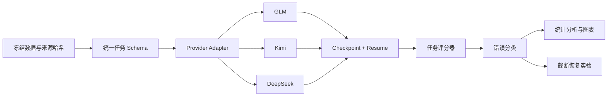
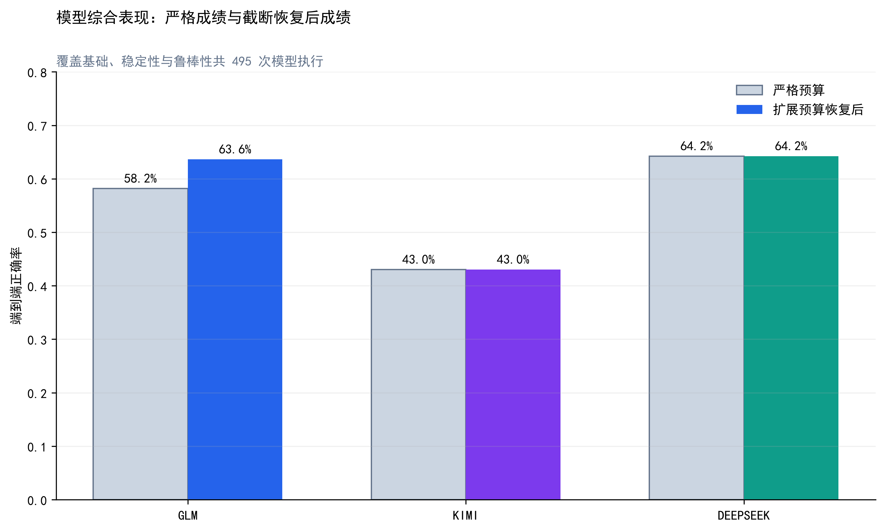
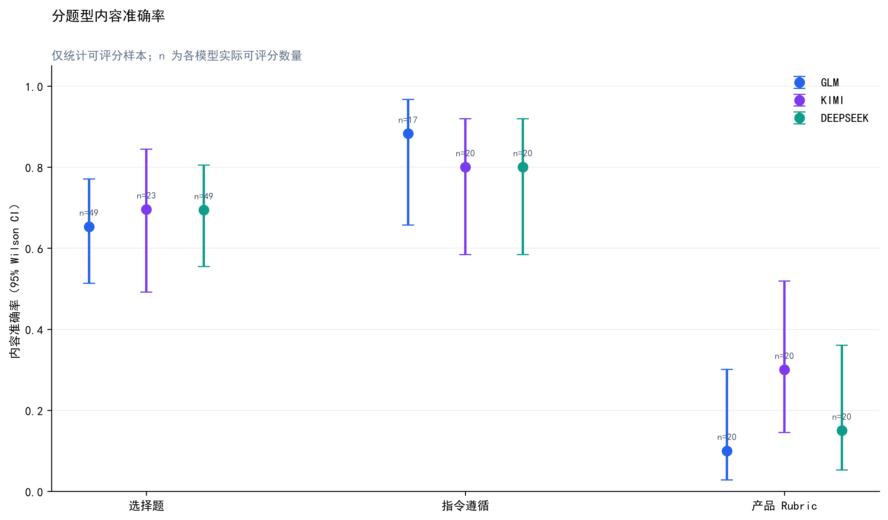
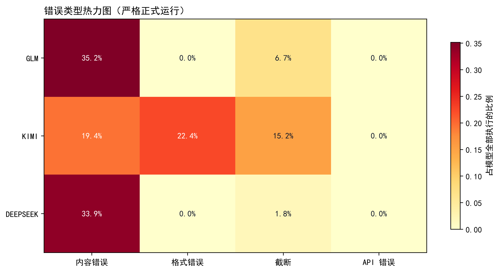
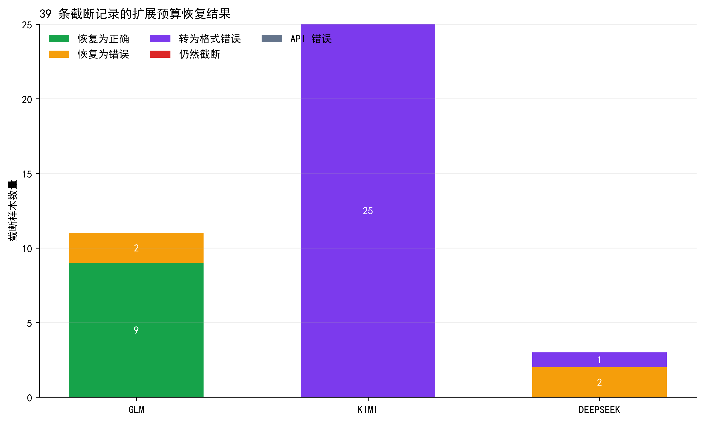

# Multidimensional LLM Evaluation

一个可复现的多模型评测与选型工程：统一比较 GLM、Kimi 与 DeepSeek 的知识能力、指令遵循、产品场景表现、鲁棒性、稳定性、延迟和接口可靠性。

> **English summary:** A reproducible Python evaluation pipeline for OpenAI-compatible LLM APIs. It separates model-content errors from formatting, truncation, grader, and provider failures; supports checkpoint resume, provider-specific rate limits, recovery experiments, confidence intervals, and portfolio-ready reports.

## 为什么做这个项目

只报一个“准确率”很容易得出错误结论。模型答错、没有按格式输出、输出被截断、接口超时和评分器异常，是不同的问题，也对应不同的产品与工程策略。本项目把这些信号拆开记录，并用同一套冻结题集、运行协议和统计口径做横向比较。

这套实现覆盖三类岗位常见能力：

- **Agent / FDE：** 多供应商 API 适配、限流、超时重试、断点续跑、可观测错误状态；
- **模型评测：** 固定题集、任务级指标、Wilson 95% 置信区间、exact McNemar、重复一致性；
- **AI 产品：** 将知识、指令遵循、业务 Rubric、质量—延迟和失败模式转化为选型建议。

## 评测设计

| 维度 | 规模 | 目的 |
|---|---:|---|
| MMLU-Pro | 50 | 数学、计算机、物理、健康、法律的高难知识推理 |
| IFEval | 20 | 可执行的指令约束遵循 |
| 产品案例 | 20 | 高校智能答疑场景的 Rubric 评分 |
| 鲁棒性变体 | 30 | 重述、干扰信息与选项置换后的性能变化 |
| 稳定性子集 | 15 × 3 次 | 同题重复回答的一致性 |

正式实验共形成 **495 条模型—题目评测记录**：90 道基础题 × 3 个模型、15 道稳定性题 × 3 次 × 3 个模型、30 道鲁棒性题 × 3 个模型。网络重试可能使实际 HTTP 请求次数更高。



## 工程能力

- OpenAI-compatible 多供应商接口与独立模型配置；
- API Key 仅从环境变量读取，配置文件不保存密钥；
- 每个供应商独立的超时、三次重试与请求间隔，Kimi 可单独设置更长限流窗口；
- JSONL checkpoint、`--resume` 断点续跑与重复运行保护；
- 按任务配置初始/恢复 token 预算，截断后进行独立后验恢复；
- 选择题动态支持 A–J，不把多余文本直接误判为正确格式；
- `correct / wrong / format_error / api_error / truncated / grader_error` 分层；
- 内容准确率、端到端成功率、格式/API/截断率、p50/p95 延迟、Token、稳定性与配对显著性；
- 原始正式结果与恢复后结果并存，避免后验补跑覆盖主实验。

## 结果快照

以下是本次固定配置和样本上的结果，不代表模型的普遍排名。模型版本与运行参数见 [`config/models.json`](config/models.json)。

| 模型 | 基础集端到端成功率 | 可评分内容准确率 | 格式错误率 | 截断率 | p50 / p95 延迟 | 重复答案一致率 |
|---|---:|---:|---:|---:|---:|---:|
| DeepSeek | 58.89% | 59.55% | 0.00% | 1.11% | 1.94s / 4.90s | 91.11% |
| GLM | 54.44% | 56.98% | 0.00% | 4.44% | 8.82s / 49.43s | 88.89% |
| Kimi | 42.22% | 60.32% | 18.89% | 11.11% | 10.91s / 34.06s | 91.11% |

关键观察：Kimi 在“已经得到可评分答案”的样本上内容准确率并不低，但格式与截断显著拉低端到端成功率。这说明上线选型不能只看知识题正确率，也要衡量结构化输出和接口行为。

后验恢复实验共补跑 39 个截断结果。扩展预算后不再有 `truncated`，但恢复结果仍可能变成 `wrong` 或 `format_error`：

| 模型 | 截断目标 | 严格端到端正确率 | 恢复后正确率 | 变化 | 恢复后格式错误 |
|---|---:|---:|---:|---:|---:|
| DeepSeek | 3 | 64.24% | 64.24% | +0.00 pp | 1 |
| GLM | 11 | 58.18% | 63.64% | +5.45 pp | 0 |
| Kimi | 25 | 43.03% | 43.03% | +0.00 pp | 25 |

因此，“加大输出 token”能解决传输层截断，却不一定解决结构化输出契约。这一差异在报告中单独统计。

### 可视化

| 模型总览 | 分任务准确率与区间 |
|---|---|
|  |  |

| 错误画像 | 截断恢复结果 |
|---|---|
|  |  |

完整产物：[`formal_evaluation_report.md`](artifacts/reports/formal_evaluation_report.md)、[`formal_summary.json`](artifacts/reports/formal_summary.json)、[`recovery_report.md`](artifacts/reports/recovery_report.md)、[`recovery_summary.json`](artifacts/reports/recovery_summary.json)。公开仓库只保留汇总结果，不包含原始模型回复或 checkpoint。

## 快速开始

### 1. 安装

```powershell
git clone https://github.com/Rianzhan/multidimensional-llm-evaluation.git
cd multidimensional-llm-evaluation
python -m venv .venv
.\.venv\Scripts\python.exe -m pip install -e ".[dev]"
```

IFEval 的部分约束依赖 NLTK 数据：

```powershell
.\.venv\Scripts\python.exe -m nltk.downloader -d data\nltk_data punkt punkt_tab
```

### 2. 设置环境变量

```powershell
$env:GLM_API_KEY="your-key"
$env:KIMI_API_KEY="your-key"
$env:DEEPSEEK_API_KEY="your-key"
```

不要把真实 Key 写进 `.env.example`、JSON、代码、日志或截图。若 Key 曾出现在聊天或终端截图中，应在供应商控制台立即轮换。

### 3. 无网络检查

```powershell
.\.venv\Scripts\python.exe evaluate.py --dry-run
```

### 4. 正式运行

```powershell
.\.venv\Scripts\python.exe evaluate.py --run-robustness --output-dir runs\run-001
```

中断后继续：

```powershell
.\.venv\Scripts\python.exe evaluate.py --run-robustness --output-dir runs\run-001 --resume
```

也可以使用 PowerShell 包装脚本；它们会隐藏输入 API Key，并优先使用仓库内 `.venv`：

```powershell
.\run_smoke.ps1
.\run_formal.ps1
```

## 目录结构

```text
├─ config/                 # 模型 ID、base URL、超时、预算与限流；不含密钥
├─ src/llm_eval/           # 评测引擎、评分器、指标、报告与恢复逻辑
├─ scripts/                # 数据获取、冻结与实验清单脚本
├─ tests/                  # 单元/集成测试
├─ data/                   # 冻结小型评测集、数据卡与来源清单
├─ third_party/ifeval/     # 固定版本的官方 IFEval 评分代码
├─ artifacts/              # 可公开的汇总报告与图表
├─ evaluate.py             # 主实验入口
└─ recover.py              # 截断恢复实验入口
```

## 可复现与安全边界

- `data/source_manifest.json` 记录上游 revision、文件 SHA256 与检索时间；
- 题集在调用模型前冻结，不依据本次模型错题反向选样；
- `runs/`、checkpoint、缓存和原始回复默认被 `.gitignore` 排除；
- 成本在没有可靠公开价格时明确显示为 `unavailable`，不臆测；
- 产品案例 Rubric 是可执行实验版本，关键业务结论仍需人工复核。

## 局限性

- MMLU-Pro 每个学科仅 10 道，应结合 Wilson 区间理解小样本波动；
- 公开基准可能存在训练污染；
- IFEval 主要衡量可验证的表面约束，不等于事实正确性；
- 供应商版本、服务负载和区域网络会影响延迟与输出行为；
- 本实验中的模型横向差异均未达到配对 McNemar 显著性阈值，结果更适合用于诊断和工程决策，而非宣称绝对排名。

## 许可证与数据来源

本仓库自有代码使用 [Apache License 2.0](LICENSE)。MMLU-Pro 与 IFEval 的来源、固定版本和第三方许可边界见 [`third_party/NOTICE.md`](third_party/NOTICE.md) 与 [`data/source_manifest.json`](data/source_manifest.json)。使用数据前请同时遵守相应上游条款。
